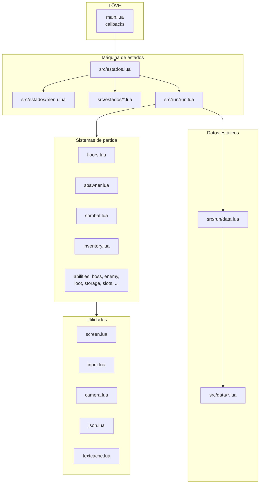
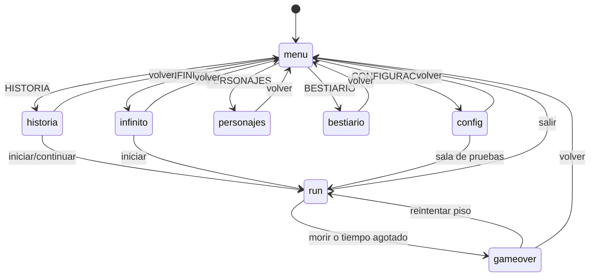
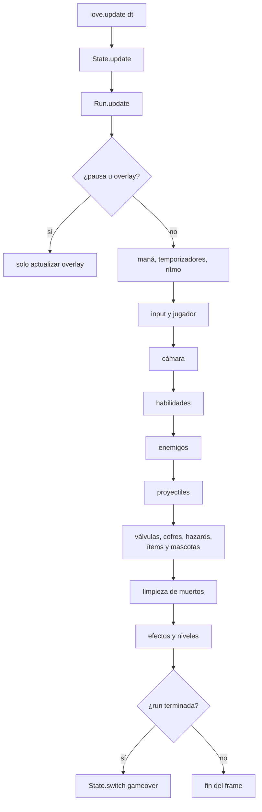
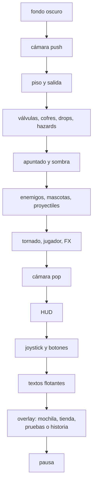
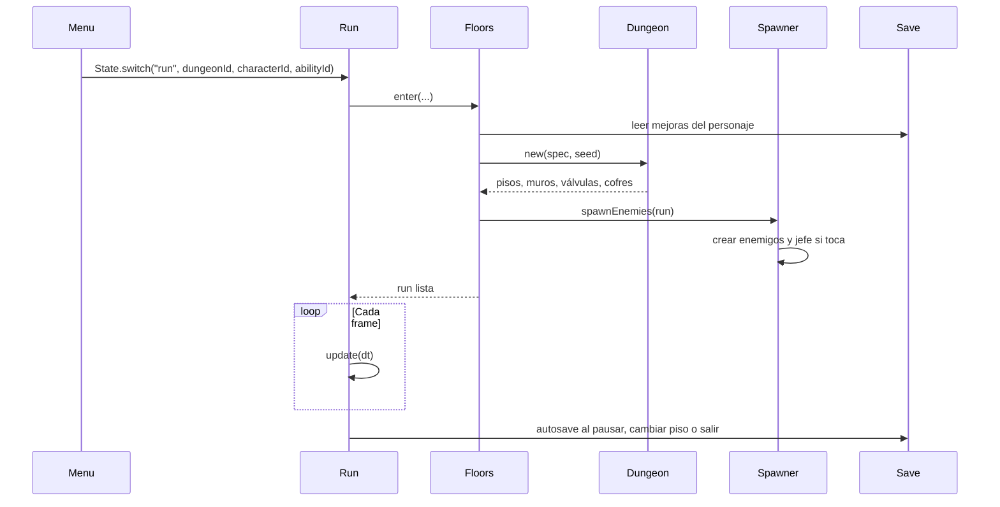
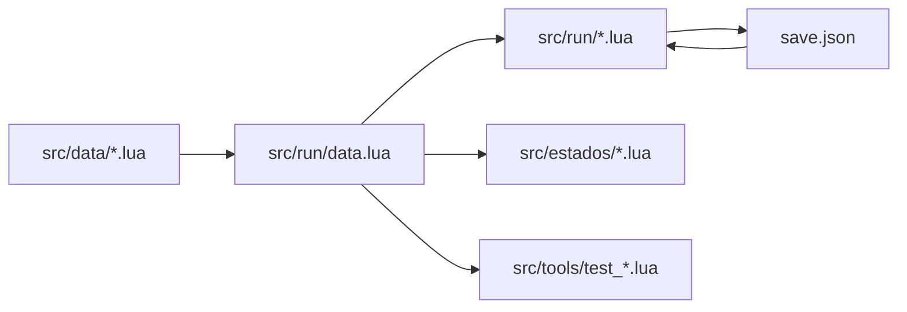

# 02 · Arquitectura y flujo

## Idea general

VaporCode separa el juego en cuatro capas:



Regla mental:

- `main.lua` solo traduce eventos de LÖVE a la máquina de estados.
- `src/estados.lua` decide qué pantalla o modo está activo.
- `src/estados/` contiene pantallas fuera de la partida.
- `src/run/` contiene la partida y sus sistemas.
- `src/data/` contiene **números y definiciones**, no lógica de dibujo.
- `src/utils/` contiene piezas reutilizables sin reglas de juego.

## `main.lua`: el único puente con LÖVE

`main.lua` implementa los callbacks globales:

| Callback | Qué hace |
|---|---|
| `love.load` | Carga fuentes, resolución, guardado, audio y abre el menú. |
| `love.update(dt)` | Limita `dt` a 0.1 s y actualiza el estado actual. |
| `love.draw` | Aplica la transformación de pantalla y dibuja el estado. |
| `love.keypressed` | F3 activa depuración; el resto va al estado. |
| `love.mousepressed` / `mousereleased` / `mousemoved` | Ignoran eventos táctiles y convierten a coordenadas virtuales. |
| `love.touchpressed` / `touchmoved` / `touchreleased` | Convierten a coordenadas virtuales y avisan al estado. |
| `love.focus` | Al perder foco, la partida se pausa y guarda. |
| `love.visible` | Si Android oculta la app, guarda por seguridad. |
| `love.quit` | Guarda el progreso antes de cerrar. |

**No agregues callbacks nuevos de LÖVE en módulos de juego.** Si necesitas un
evento nuevo, agrégalo en `main.lua` y pásalo por `src/estados.lua` como los demás.

## Máquina de estados

Un estado es una tabla con funciones opcionales:

```lua
local MiEstado = {}

function MiEstado.enter(...) end
function MiEstado.leave() end
function MiEstado.update(dt) end
function MiEstado.draw() end
function MiEstado.keypressed(key, isrepeat) end
function MiEstado.mousepressed(x, y, button) end
function MiEstado.mousereleased(x, y, button) end
function MiEstado.mousemoved(x, y) end
function MiEstado.touchpressed(id, x, y) end
function MiEstado.touchmoved(id, x, y) end
function MiEstado.touchreleased(id, x, y) end
function MiEstado.focus(focused) end

return MiEstado
```

`src/estados.lua` busca el módulo así:

- `State.switch("menu")` carga `src/estados/menu.lua`.
- `State.switch("config")` carga `src/estados/config.lua`.
- `State.switch("run", ...)` carga `src/run/run.lua`.



### Regla importante de estados

Cuando cambies de estado, el estado anterior recibe `leave()` y el nuevo `enter(...)`.
Limpia input, audio y overlays en `leave` o `enter` para no arrastrar gestos de una
pantalla a otra.

## `run.lua`: el orquestador de la partida

`src/run/run.lua` es una **tabla singleton** que representa la run actual. No es
una clase que instancies; el juego tiene una sola run a la vez.

Tiene dos responsabilidades:

1. Implementar el estado `run` (`update`, `draw`, `keypressed`, input táctil).
2. Montar métodos de sistemas hermanos sobre la misma tabla.

Los sistemas se cargan al final del archivo:

```lua
local systems = {
  sys("src.run.spawner"),
  sys("src.run.combat"),
  sys("src.run.tornado"),
  sys("src.run.walls"),
  sys("src.run.progression"),
  sys("src.run.inventory"),
  sys("src.run.storage"),
  sys("src.run.loot"),
  sys("src.run.slots"),
  sys("src.run.story_flow"),
}
```

Cada función de esos módulos se copia a `Run`:

```lua
function Spawner.createEnemy(run, kind, x, y, options) ... end
```

se usa como:

```lua
run:createEnemy("automaton", x, y)
```

Por eso los sistemas reciben `run` como **primer argumento**. Es un patrón para
mantener archivos pequeños sin perder la API `run:metodo(...)`.

### Protección contra choques

Al montar los sistemas, `run.lua` lanza un error si un módulo intenta redefinir un
campo que ya existe en `Run`. Si ves algo como:

```text
Run ya define update; el sistema no puede repetirlo
```

elegiste un nombre de método que ya existe. Renómbralo.

### Qué NO vive en `run.lua`

- Reglas de combate: `combat.lua`.
- Creación de enemigos: `spawner.lua`.
- Arranque de pisos: `floors.lua`.
- Inventario: `inventory.lua` y `storage.lua`.
- Datos y números: `src/data/`.
- Dibujo del HUD: `hud.lua`.

`run.lua` debe coordinar, no concentrar todo.

## El frame de una partida



En `love.draw` el orden es:



Si agregas algo visual, decide **en qué capa** va. Un enemigo nunca debe dibujarse
después del HUD. Un efecto de mundo debe dibujarse dentro de la cámara.

## Ciclo de vida de una run



### Semilla y reproducibilidad

- `run.seed` se crea al entrar a la run.
- Cada piso usa `run.seed + run.depth * 7919`.
- `Dungeon.new` crea un generador propio: `love.math.newRandomGenerator(seed)`.
- El mapa y la posición de válvulas/cofres son reproducibles con la misma semilla.
- El botín, élites y algunas decisiones de IA usan `love.math.random` global. No
  asumas que **todo** el contenido de la run es reproducible todavía.

Si agregas contenido procedural que deba repetirse con la semilla, usa
`run.dungeon.rng`, no `love.math.random`.

## Flujo de datos



Los módulos de juego **nunca** deben requerir `src/data/enemies.lua` directamente.
Siempre usan:

```lua
local Data = require("src.run.data")
```

Así el equipo puede mover definiciones entre archivos sin romper el juego.

## Dónde va cada tipo de archivo

| Si vas a agregar... | Va en... |
|---|---|
| Números, enemigos, ítems, jefes, mazmorras | `src/data/` |
| Una regla nueva de partida | `src/run/` |
| Una pantalla fuera de la partida | `src/estados/` |
| Input, cámara, pantalla, audio, JSON | `src/utils/` |
| Un test | `src/tools/test_*.lua` |
| Documentación | `docs/` o `GuiaVaporCode/` |

## Convención de módulos

```lua
-- archivo.lua: una línea que explica su responsabilidad.
local Dependencia = require("src.ruta.dependencia")

local Modulo = {}

function Modulo.hacerAlgo(parametro)
  return parametro
end

return Modulo
```

- Variables y funciones en `snake_case`.
- Tablas que actúan como clases en `PascalCase`.
- Constantes y datos en `PascalCase` si son módulos, o claves claras si son tablas.
- Nada de variables globales, salvo los callbacks de LÖVE en `main.lua` y el mock
  de `love` en los tests.
- Comentarios en español, solo para explicar decisiones o trampas.

## Resumen

- `main.lua` conecta LÖVE con el juego.
- `src/estados.lua` cambia pantallas.
- `src/run/run.lua` coordina la partida.
- Los sistemas reciben `run` y se montan como métodos.
- Los datos viven en `src/data/` y se leen por `Data`.
- Los tests no necesitan LÖVE real.
