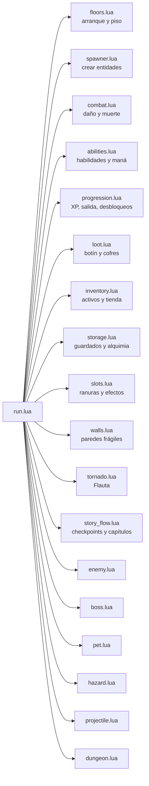
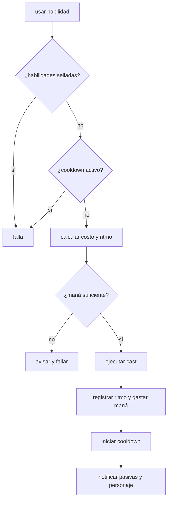
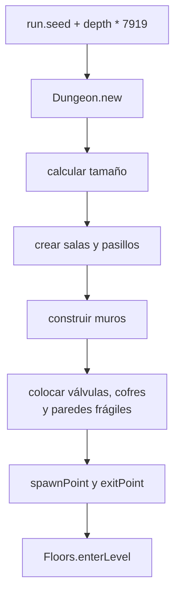

# 03 · Sistemas de juego

Esta sección explica qué hace cada sistema y dónde vive. No necesitas memorizar
todo, pero sí saber **dónde buscar** cuando agregues contenido.

## Mapa de sistemas



## Jugador y ataque automático

Archivo: `src/run/player.lua`.

El jugador:

- Se mueve con el joystick o con WASD/flechas.
- Ataca solo al enemigo más cercano con línea de visión.
- Tiene invulnerabilidad breve después de recibir daño.
- Aplica la pasiva del personaje elegido.

Personajes actuales:

| Personaje | Básico | Pasiva |
|---|---|---|
| Amado | proyectil a distancia | marca hasta 3 enemigos: +15% daño y −10% velocidad |
| Mar | giro cuerpo a cuerpo | dash al usar habilidades mientras se mueve |
| Amileth | cadena de 2 saltos | escudo del 10% que se repara fuera de combate |

El ataque se intenta cuando `attackTimer <= 0`. Si no hay objetivo visible, se
reintenta en el siguiente frame. La cadencia sale de `run.stats.attackRate`, que
puede modificarse con Turbo.

### Regla para tocar al jugador

- No cambies `Player:update` para reglas de armas nuevas.
- Para una mecánica nueva, crea un sistema en `src/run/` y llámalo desde `Run.update`.
- Si afecta stats, usa `run.stats`; si afecta estado temporal, usa campos de `run`
  o del jugador y límpialos en `Floors.enter`.

## Enemigos, roles y élites

Archivos:

- Datos: `src/data/enemies.lua`.
- Lógica: `src/run/enemy.lua`.
- Creación: `src/run/spawner.lua`.

Cada enemigo se define en `Enemies.enemyTypes` con valores como:

```lua
automaton = {
  radius = 14,
  speed = 64,
  hp = 32,
  damage = 10,
  xp = 7,
  color = { 0.72, 0.28, 0.22 },
  keepDistance = false,
}
```

El rol se elige con `role` o, si no existe, por `keepDistance`:

| Rol | Comportamiento | Ejemplos |
|---|---|---|
| `chaser` | persigue en línea recta | autómata, caldera, sabueso |
| `turret` | inmóvil, dispara a distancia | centinela |
| `ranged` | mantiene distancia y dispara | espectro |
| `mortar` | lanza zonas con retardo | artillero |
| `summoner` | huye e invoca aliados | maquinista |
| `trapper` | flanquea y deja minas | saboteador |
| `blight` | ralentiza con contacto/proyectil | peste |
| `healer` | cura aliados cercanos | clérigo |
| `mana_hunter` | drena maná y sella habilidades | inquisidor |

La IA se actualiza en `Enemy:updateRole`. Si agregas un rol nuevo, agrega una rama
ahí y documenta sus campos de datos.

### Élites

15% de probabilidad por enemigo elegible. Modificadores:

- `volatile`: explota al morir.
- `armored`: escudo de 50.
- `spectral`: se vuelve intocable 0.5 s cada 2 s.

Los jefes y los enemigos con `noElite = true` no pueden ser élite.

### Aparición

`Spawner.spawnEnemies` calcula:

```text
cantidad = spawnBase de la mazmorra + (piso - 1) * perDepth
```

y la limita con `Data.spawn.maxEnemies` (12). La vida y el daño escalan con
`hpScale` y `damageScale` de la mazmorra. El jefe aparece cuando
`run.depth % Data.bossEvery == 0`.

## Combate y muerte

Archivo: `src/run/combat.lua`.

Responsabilidades:

- Buscar el enemigo más cercano con línea de visión (`nearestEnemy`).
- Aplicar marca de Amado.
- Resolver el giro cuerpo a cuerpo de Mar.
- Curar enemigos alrededor (clérigo).
- Explotar élites volátiles.
- Repartir monedas, XP, botín y resonancias al morir un enemigo.
- Disparar pasivas: veneno, vampiro, hada, pólvora y flauta.

El daño a un enemigo entra por `Enemy:takeDamage(amount, run, source)`. Si un
efecto nuevo necesita reaccionar al daño, revisa `Combat.onEnemyDamaged` y
`Combat.onEnemyKilled` antes de inventar otro camino.

### Fuentes de daño

`source` es un texto corto. Los valores actuales incluyen:

- `"basic"`: ataque automático.
- `"ability"`: habilidad activa.
- `"pet"`: mascota.
- `"poison"`, `"gunpowder"`, `"elite"`, `"hazard"`.

No inventes una fuente sin revisar quién la consume. Varias pasivas solo
reaccionan a `"basic"`.

## Maná y habilidades

Archivos:

- Datos: `src/data/abilities.lua`.
- Lógica: `src/run/abilities.lua`.
- Ranuras y efectos del jugador: `src/run/slots.lua`.

Maná compartido:

- Máximo: 100.
- Regeneración base: 2.5/s.
- Después de 5 s sin gastar: regenera al triple.

Habilidades actuales:

| Id | Nombre | Ranura | Costo | Enfriamiento |
|---|---|---|---|---|
| `resonance` | Resonancia | A1/A2 | 28 | 6 s |
| `shield` | Escudo | E fija | 35 | 10 s |
| `turbo` | Turbo | T fija | 30 | 12 s |
| `light_arrow` | Flecha de luz | A1/A2 | 22 | 5 s |
| `shadow_swap` | Intercambio de sombra | A1/A2 | 30 | 8 s |

`Abilities.cast` hace esta secuencia:



Los casts concretos viven en la tabla local `casts` de `src/run/abilities.lua`.
Agregar una habilidad sin registrar su cast hace que exista en los datos pero no
se pueda usar.

## Ritmo

Archivo: `src/run/rhythm.lua`.

- Cada mazmorra trae `song` con nombre y BPM.
- `Rhythm.enter(song)` reinicia el reloj al empezar el piso.
- `Rhythm.update(dt)` avanza pulso, compás y click.
- `Rhythm.inWindow()` devuelve si estás dentro de la ventana de acierto.
- `Rhythm.justBeat` y `Rhythm.justStrongBeat` son útiles para mascotas y feedback.

La ventana actual es de ±0.12 s (`Data.rhythm.hitWindow`). El multiplicador
perfecto x2 se aplica hoy en **Resonancia**; si quieres extenderlo a otra
habilidad, hazlo dentro de su cast y agrega un test.

No uses `love.timer.getTime()` para calcular el pulso. Usa `Rhythm` para que todos
los sistemas escuchen el mismo reloj.

## Enemigos especiales: jefes

Archivos:

- Datos: `src/data/bosses.lua`.
- Lógica: `src/run/boss.lua`.

Un jefe es un enemigo con:

```lua
boss = true,
bossKind = "patriarch",
```

`Data.enemyTypes` mezcla los enemigos regulares y los jefes, así que una mazmorra
puede referenciar a ambos con la misma clave. `Boss.update` decide la IA según
`bossKind`:

| `bossKind` | Jefe |
|---|---|
| `guardian` | Guardián de la Caldera |
| `patriarch` | Patriarca de Huesos y Cobre |
| `forge` | Forja Viviente |
| `chrono` | Inquisidor del Tiempo |
| `organ` | Órgano del Tiempo |

Los jefes son inmunes al aturdimiento. Al morir sueltan una resonancia del
personaje de la run, excepto en la sala de pruebas.

## Pisos, mazmorras y hazards

Archivos:

- Arranque y reintento: `src/run/floors.lua`.
- Generación: `src/run/dungeon.lua`.
- Peligros: `src/run/hazard.lua`.
- Paredes frágiles: `src/run/walls.lua`.
- Válvulas: `src/run/valve.lua`.
- Cofres: `src/run/chest.lua`.

Una mazmorra define:

```lua
{
  id = "cripta",
  name = "Cripta de latón",
  unlockLevel = 0,
  song = { name = "Pulso de latón", bpm = 104 },
  enemies = { "automaton", "caldera", "artillero", "maquinista", "peste" },
  boss = "bone_patriarch",
  spawnBase = 4,
  hpScale = 0.12,
  damageScale = 0.08,
}
```

### Generación del piso



El piso se guarda en una instantánea con `Floor.capture` para reintentar exacto
desde game over.

### Tipos de hazard

- `fire`: daño por tick.
- `mine`: se arma, vive 60 s y explota.
- `beam`: rayo giratorio de jefe.
- `zone`: zona de fuego de jefe.
- `cone`: cono congelante del Inquisidor.

## Botín, ítems e inventario

Archivos:

- Datos: `src/data/items.lua`.
- Botín: `src/run/loot.lua`.
- Inventario activo: `src/run/inventory.lua`.
- Guardados y alquimia: `src/run/storage.lua`.
- Ítems en el suelo: `src/run/item_drop.lua`.

Tipos de ítem:

| `kind` | Qué hace |
|---|---|
| `passive` | Efecto mientras está activo; algunos se acumulan hasta 5. |
| `ability` | Se asigna a A1/A2 desde la mochila y se consume. |
| `pet` | Invoca una mascota única. |
| `character` | Desbloquea a Mar o Amileth. |
| `resonance` | Da un punto permanente al personaje; no ocupa mochila. |

Reglas:

- Hay **5 espacios activos** y **15 guardados**.
- Solo los activos aplican efectos y se ven en el HUD.
- Las habilidades siempre caen en guardados.
- Pasivas y mascotas entran activas si hay hueco; si no, quedan guardadas.
- Dos pasivas iguales del mismo nivel, guardadas, se combinan con alquimia.
- Los ítems del suelo duran 7 s y parpadean al final.

## Mascotas

Archivo: `src/run/pet.lua` y datos en `Items.pets`.

- Perro: muerde al ritmo, aturde y es inmune al cuerpo a cuerpo.
- Gato: los enemigos lo ignoran.
- Dragón: aliento potente, débil al cuerpo a cuerpo.
- Hámster: recoge ítems y puede romper paredes frágiles al pulso fuerte.

Las mascotas actúan en beats, no con temporizadores independientes. Si agregas
una, revisa `Pet:update` y `Pet:snapshot` para que sobreviva al cambio de piso.

## Tienda y alquimia

- La tienda se abre al nivel 15 y piso 10.
- Los precios están en `Data.shop.prices`.
- La alquimia solo usa ítems pasivos **guardados**.
- Costos de alquimia: 10, 30, 50 y 150 monedas para x2, x3, x4 y x5.

La tienda no está disponible en la sala de pruebas, y la alquimia tampoco gasta
monedas ahí.

## Modo Historia

Archivos:

- Datos: `src/data/story.lua`.
- Reglas: `src/run/story.lua`.
- Flujo y checkpoints: `src/run/story_flow.lua`.
- Presentación: `src/run/story_ui.lua`.

La campaña tiene cuatro capítulos con escenas, portales y un final. Las escenas
se guardan por personaje en `Story.characterScenes`; si no existe variante, se usa
la escena base.

El checkpoint se guarda al empezar cada piso y permite `CONTINUAR HISTORIA` sin
repetir escenas ya vistas. Al completar el piso final de la Torre se marca esa
historia como completada y la Torre se desbloquea cuando las tres están listas.

## Sala de pruebas

Archivo: `src/run/sandbox.lua`.

- No hay oleadas, temporizador, salida ni jefes automáticos.
- El panel `PRUEBAS` o F2 invoca enemigos, da ítems, vacía inventario y alterna
  invulnerabilidad.
- No escribe monedas, récords, desbloqueos ni bestiario en el guardado real.
- La tienda y la alquimia están bloqueadas.

Si agregas contenido, pruébalo también aquí. Es la forma más rápida de ver un
enemigo o ítem sin jugar una run completa.

## Audio

Archivo: `src/utils/audio.lua`.

- La música es un bucle procedural de 4 s generado con `love.sound`.
- El BPM cambia el `pitch` de la misma pista.
- Los efectos se registran en un bus para respetar el volumen del usuario.
- Sin `love.audio` (tests), todo el audio queda inactivo sin romper.

No agregues pistas grandes sin hablarlo. El paquete actual es pequeño y esa es una
ventaja que debemos conservar.
