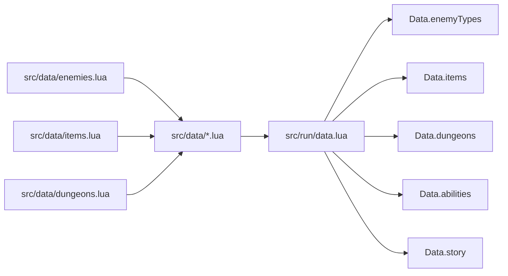
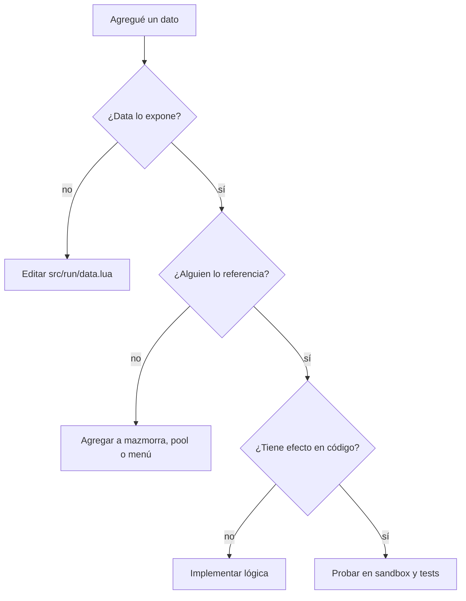

# 04 · Datos y balance

## Principio: datos separados de lógica

Todo el contenido estático vive en `src/data/`. La lógica de juego vive en
`src/run/` y las pantallas en `src/estados/`. Un cambio de balance no debería
obligarte a tocar código de combate.



Nunca hagas esto en un sistema de partida:

```lua
local Enemies = require("src.data.enemies") -- ❌
```

Haz esto:

```lua
local Data = require("src.run.data")

local def = Data.enemyTypes.automaton -- ✅
```

Así el equipo puede mover datos entre archivos sin romper el resto del juego.

## Archivos de datos

| Archivo | Contenido |
|---|---|
| `abilities.lua` | Habilidades activas, maná y set intercambiable. |
| `balance.lua` | Jugador, economía, piso, válvulas, cofres, cámara, ritmo, colores. |
| `bosses.lua` | Jefes, fases y patrones. |
| `characters.lua` | Personajes, marca de Amado y desbloqueos. |
| `dungeons.lua` | Mazmorras, índice por id y cadencia de jefes. |
| `enemies.lua` | Enemigos regulares, élites, hazards, IA y aparición. |
| `items.lua` | Ítems, mascotas, mochila, tienda, alquimia y botín. |
| `story.lua` | Actos, capítulos, escenas y lore. |
| `upgrades.lua` | Mejoras permanentes. |

## Unidades y convenciones

- **Velocidad:** píxeles por segundo (px/s).
- **Radios y distancias:** píxeles del mundo virtual.
- **Tiempo:** segundos.
- **Daño:** número plano que se multiplica por stats cuando corresponde.
- **Probabilidades:** fracción entre 0 y 1 (`0.15` = 15%).
- **Colores:** tablas `{ r, g, b }` con valores de 0 a 1.
- **Ids:** minúsculas, sin espacios, en inglés y estables. Ejemplo: `bone_patriarch`.
- **Nombres visibles:** español, con acentos si hace falta.

### No cambies ids sin migración

Los ids se guardan en el guardado (`bestiary`, `unlocked`, `characters`,
`progress`) y en las referencias entre datos. Si renombras `auto_hammer` a
`steam_hammer`, rompes partidas existentes. Si de verdad necesitas renombrar,
conserva un alias o escribe una migración.

## `balance.lua`: los números globales

Los valores más importantes:

```lua
Balance.player = {
  radius = 16,
  attackRate = 2.7,
  attackRange = 520,
  invulnTime = 0.18,
  levelDamage = 1,
  levelMaxHp = 6,
  levelHeal = 14,
  xpBase = 20,
  xpStep = 16,
  exitRadius = 26,
  exitDelay = 0.6,
  nextLevelHealPercent = 0.15,
}
```

| Campo | Efecto |
|---|---|
| `attackRate` | Ataques por segundo del personaje. |
| `attackRange` | Alcance base del ataque a distancia. |
| `invulnTime` | Invulnerabilidad tras recibir daño. |
| `levelDamage` | Daño extra por nivel de personaje. |
| `levelMaxHp` | Vida máxima extra por nivel. |
| `levelHeal` | Curación al subir de nivel. |
| `xpBase` / `xpStep` | Curva de experiencia. |
| `exitDelay` | Retraso para abrir la salida al limpiar el piso. |

Otros bloques:

- `Balance.economy`: monedas y XP por moneda.
- `Balance.floor`: tiempo límite y aviso.
- `Balance.valve`: válvulas de vapor.
- `Balance.destructible`: paredes frágiles.
- `Balance.chest`: cofres.
- `Balance.dungeonGen`: tamaño, salas, pasillos y línea de visión.
- `Balance.camera`: zona de arrastre y margen de cámara.
- `Balance.projectile`: velocidades, radios y duración.
- `Balance.rhythm`: BPM por defecto y ventanas de ritmo.
- `Balance.colors`: paleta base.

### Cuidado con los tipos

Los campos numéricos deben ser números, no booleanos. Un `keepDistance = true`
en un enemigo rompe comparaciones como `distance < keepDistance`. Para un
perseguidor puro usa `keepDistance = false` o simplemente no lo pongas.

El test `test_data.lua` valida esto. Si lo rompes, el test te avisa.

## Enemigos

Esquema mínimo:

```lua
mi_enemigo = {
  name = "Nombre visible",       -- opcional; si falta se usa el id
  radius = 15,
  speed = 60,
  hp = 50,
  damage = 12,
  xp = 10,
  color = { 0.8, 0.4, 0.2 },
  role = "chaser",               -- opcional
}
```

Campos por rol:

| Rol | Campos útiles |
|---|---|
| `chaser` | `radius`, `speed`, `hp`, `damage` |
| `turret` | `attackInterval`, `attackRange`, `firstAttackDelay`, `projectileSpeed`, `projectileRadius` |
| `ranged` | `keepDistance`, `attackInterval`, `attackRange` |
| `mortar` | `keepDistance`, `retreatDistance`, `mortarRadius`, `mortarDamage`, `mortarDelay`, `fireDuration` |
| `summoner` | `fleeDistance`, `summonKind`, `summonCap`, `attackInterval` |
| `trapper` | `flankDistance`, `attackInterval` |
| `blight` | `attackRange`, `contactSlowDuration`, `contactSlowFactor`, `projectileSlowDuration`, `projectileSlowFactor` |
| `healer` | `healRadius`, `healPercent`, `keepDistance`, `retreatDistance` |
| `mana_hunter` | `attackRange`, `keepDistance`, `retreatDistance`, `manaDrain`, `abilityLock` |

Además:

- `noDrop = true`: no suelta botín ni XP.
- `noElite = true`: nunca sale como élite.
- `boss = true` + `bossKind`: jefe.

## Jefes

Esquema mínimo:

```lua
mi_jefe = {
  name = "Nombre",
  radius = 28,
  speed = 30,
  hp = 500,
  damage = 20,
  xp = 100,
  color = { 0.8, 0.5, 0.3 },
  boss = true,
  bossKind = "mi_kind",
}
```

Los campos extra dependen de `bossKind`. Los patrones actuales usan invocaciones,
fases, rayos, zonas, auras y conos. Copia el jefe más parecido y ajusta números
antes de escribir lógica nueva.

## Personajes

Esquema:

```lua
amado = {
  id = "amado",
  name = "Amado",
  color = { 0.50, 0.90, 1.00 },
  desc = "Texto corto para la ficha.",
  speedMultiplier = 1,
  attackRate = 2.7,
  basic = "ranged",              -- ranged | melee | chain
  attackRange = 520,
}
```

Campos específicos:

- `mark`: reglas de la marca de Amado.
- `meleeRangeMinFactor`, `meleeRangeMaxFactor`, `meleeLevelSpan`: alcance de Mar.
- `dashRadiusFactor`, `dashInvuln`, `dashSearch`: dash de Mar.
- `chain`: configuración de la cadena de Amileth.
- `shieldPercent`, `shieldRepairDelay`, `shieldRepairRate`: escudo de Amileth.

## Habilidades

Esquema:

```lua
mi_habilidad = {
  id = "mi_habilidad",
  name = "Nombre",
  short = "M",
  desc = "Qué hace.",
  cooldown = 6,
  manaCost = 28,
  color = { 0.5, 0.9, 1.0 },
}
```

Si es intercambiable, agrégala a `Abilities.exchangeable`. Si no, solo puede usarse
en una ranura fija.

Recuerda: **los datos no ejecutan la habilidad**. El efecto debe implementarse en
`src/run/abilities.lua`.

## Ítems

Esquema general:

```lua
mi_item = {
  id = "mi_item",
  kind = "passive",              -- passive | ability | pet | character | resonance
  name = "Nombre",
  short = "MIO",
  color = { 0.5, 0.8, 0.5 },
  desc = "Texto para la mochila y la tienda.",
  stackable = true,
  maxStacks = 5,
  weight = 10,
}
```

- `weight` controla la probabilidad relativa en `Data.itemPool`.
- `weight = 0` significa que no aparece por botín normal.
- Para habilidades: `abilityId` debe existir en `Data.abilities`.
- Para mascotas: `pet` debe existir en `Data.pets`.
- Para personajes: `characterId` debe existir en `Data.characters`.
- Para resonancias: `characterId` y `weight = 0`.

### Pools de botín

`Items.itemPool` tiene tres listas:

- `normal`: enemigos regulares.
- `boss`: jefes.
- `chest`: cofres.

Si agregas un ítem y quieres que salga, agrégalo a la lista correspondiente. Si
es único o especial, déjalo fuera y entrégalo por código.

## Mazmorras

Esquema:

```lua
{
  id = "mi_mazmorra",
  name = "Mi mazmorra",
  unlockLevel = 6,
  desc = "Texto para el menú.",
  song = { name = "Nombre del pulso", bpm = 128 },
  enemies = { "enemigo_a", "enemigo_b" },
  boss = "mi_jefe",
  spawnBase = 5,
  hpScale = 0.16,
  damageScale = 0.10,
}
```

- `unlockLevel` se compara con el piso alcanzado en modo Infinito.
- `storyUnlock = true` significa que no se abre por piso, sino por historia.
- `sandbox = true` marca una mazmorra de pruebas que no aparece en el menú.
- `bossEvery` está en `Dungeons.bossEvery` y hoy es 3 para todas las mazmorras.

## Mejoras permanentes

Esquema:

```lua
damage = {
  label = "Filo de vapor",
  desc = "Daño +4",
  base = 10,
  step = 4,
  maxLevel = 8,
}
```

`Save.stat(id, characterId)` calcula `base + step * nivel`. Las mejoras son por
personaje.

## Reglas de balance

1. Cambia **un número a la vez** y prueba.
2. Ajusta primero el dato, no la lógica.
3. Si un enemigo se siente injusto, revisa su rol antes de bajarle la vida.
4. No hagas jefes inmunes a todo; los jefes ya son inmunes al aturdimiento.
5. Mantén el tiempo de piso y la cantidad de enemigos dentro del presupuesto.
6. Los ítems con `weight` alto aparecen demasiado. Revisa la suma total del pool.
7. Si un cambio afecta economía, revisa precios de tienda y alquimia.
8. Si un cambio afecta supervivencia, pruébalo con los tres personajes.

## Cómo saber si un dato está bien conectado

Antes de escribir lógica nueva, verifica:

- ¿El id existe en el archivo correcto?
- ¿`src/run/data.lua` lo expone?
- ¿La mazmorra lo referencia correctamente?
- ¿El pool de botín lo incluye si debe aparecer?
- ¿El test de datos sigue pasando?
- ¿Aparece en la sala de pruebas si es enemigo o ítem?


