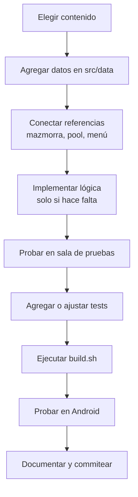

# 05 · Recetas de contenido

Esta sección es práctica: copia el patrón del contenido existente, cambia lo
mínimo y prueba. Cada receta termina con una lista de verificación.

> Antes de empezar, abre una terminal en la raíz del proyecto y deja listo:
> `love .` para probar y `sh src/tools/test_all.sh` para validar.

## Ruta general de una contribución



## Receta 1: agregar un enemigo regular

Ejemplo: un enemigo perseguidor llamado `steam_hound`.

### Paso 1: definir el enemigo

En `src/data/enemies.lua`, dentro de `Enemies.enemyTypes`:

```lua
steam_hound = {
  name = "Sabueso de Vapor",
  radius = 13,
  speed = 88,
  hp = 38,
  damage = 11,
  xp = 9,
  color = { 0.52, 0.44, 0.78 },
  keepDistance = false,
},
```

### Paso 2: registrarlo en el Bestiario

En el mismo archivo:

```lua
Enemies.bestiaryOrder = {
  -- ...
  "steam_hound",
}

Enemies.bestiary = {
  -- ...
  steam_hound = {
    name = "Sabueso de Vapor",
    desc = "Cierra la distancia rápido y castiga los huecos entre dash y dash.",
  },
}
```

### Paso 3: hacer que aparezca

Agrégalo a una mazmorra en `src/data/dungeons.lua`:

```lua
enemies = { "automaton", "caldera", "steam_hound" },
```

Si quieres que también salga en la sala de pruebas, revisa cómo `sandbox.lua`
arma su catálogo; suele leer el Bestiario y los tipos existentes.

### Paso 4: probar

1. `love .`
2. Entra a Configuración → Sala de pruebas.
3. Invoca el enemigo.
4. Revisa movimiento, daño, muerte, botín y Bestiario.
5. Ejecuta `sh src/tools/test_all.sh`.

### Checklist

- [ ] Id en minúsculas y estable.
- [ ] `radius`, `speed`, `hp`, `damage`, `xp` son números.
- [ ] `keepDistance` es `false` o un número, nunca `true`.
- [ ] Está en `bestiaryOrder` y `bestiary`.
- [ ] Aparece en al menos una mazmorra.
- [ ] Se ve bien en 16:9 y 20:9.
- [ ] No rompe `test_data.lua`.

## Receta 2: agregar un rol de enemigo

Ejemplo: un enemigo que orbita al jugador y dispara.

### Paso 1: definir los datos

```lua
orbital_mage = {
  name = "Mago Orbital",
  radius = 15,
  speed = 55,
  hp = 60,
  damage = 12,
  xp = 15,
  color = { 0.42, 0.72, 0.92 },
  role = "orbital",
  attackInterval = 2.5,
  orbitRadius = 180,
  firstAttackDelay = 1.2,
},
```

### Paso 2: implementar el rol

En `src/run/enemy.lua`, agrega una función:

```lua
function Enemy:updateOrbital(dt, run, target, distance, nx, ny)
  local def = self.def
  local angle = Util.atan2(self.y - target.y, self.x - target.x)
  local desiredX = target.x + math.cos(angle) * (def.orbitRadius or 180)
  local desiredY = target.y + math.sin(angle) * (def.orbitRadius or 180)
  self:move(dt, run, desiredX - self.x, desiredY - self.y, 1)

  self.shootTimer = self.shootTimer - dt
  if self.shootTimer <= 0 then
    self.shootTimer = def.attackInterval or 2.5
    self:shoot(run, target, { damageScale = 0.9 })
  end
end
```

Y conéctala en `Enemy:updateRole`:

```lua
elseif role == "orbital" then
  self:updateOrbital(dt, run, target, distance, nx, ny)
```

### Paso 3: probar y documentar

Agrega un test en `src/tools/test_enemy_roles.lua` o amplía `test_v6.lua`.
Documenta los campos nuevos en esta guía y en `docs/design.md` si cambian el diseño.

### Checklist

- [ ] El rol nuevo tiene una rama explícita en `updateRole`.
- [ ] Los campos nuevos están documentados.
- [ ] No usa `love.graphics` dentro de la lógica.
- [ ] Tiene test o se prueba en sandbox.
- [ ] No rompe roles existentes.

## Receta 3: agregar un jefe

Los jefes son enemigos con `boss = true` y un `bossKind` que decide su IA.

### Paso 1: definir el jefe

En `src/data/bosses.lua`, dentro de `Bosses.types`:

```lua
steam_conductor = {
  name = "Director de Vapor",
  radius = 26,
  speed = 40,
  hp = 640,
  damage = 22,
  xp = 120,
  color = { 0.72, 0.48, 0.92 },
  boss = true,
  bossKind = "conductor",
  summonKind = "automaton",
  summonInterval = 5.5,
  firstSummonDelay = 2.0,
  summonCap = 5,
  phaseThresholds = { 0.60, 0.30 },
  phaseDuration = 4.0,
  beamCount = 5,
  beamLength = 600,
  beamWidth = 10,
  beamRotation = 0.6,
  beamDamage = 9,
},
```

### Paso 2: registrarlo en el Bestiario

En `Bosses.bestiaryOrder` y `Bosses.bestiary`.

### Paso 3: conectarlo a una mazmorra

En `src/data/dungeons.lua`:

```lua
boss = "steam_conductor",
```

### Paso 4: implementar la IA

En `src/run/boss.lua`:

1. Agrega una función `updateConductor(enemy, dt, run, ctx)`.
2. Agrégala a `Boss.update`:

```lua
elseif kind == "conductor" then
  updateConductor(enemy, dt, run, ctx)
```

3. Si necesita un dibujo especial, agrega una rama en `Boss.drawOverlay`.

### Paso 5: probar

- Invócalo desde la sala de pruebas.
- Revisa fases, invocaciones, daño, muerte y resonancia.
- Comprueba que no se puede aturdir.
- Ejecuta tests.

### Checklist

- [ ] `boss = true` y `bossKind` definidos.
- [ ] Está en `Bosses.bestiaryOrder` y `Bosses.bestiary`.
- [ ] La mazmorra lo referencia.
- [ ] `Boss.update` tiene su rama.
- [ ] Suelta resonancia al morir fuera de sandbox.
- [ ] Se probó en un piso múltiplo de 3 (o en el piso de historia correcto).

## Receta 4: agregar un ítem pasivo

Ejemplo: `magnet`, que atrae monedas o ítems.

### Paso 1: definir el ítem

En `src/data/items.lua`, dentro de `Items.items`:

```lua
magnet = {
  id = "magnet",
  kind = "passive",
  name = "Imán de taller",
  short = "IMA",
  color = { 0.45, 0.70, 0.95 },
  desc = "Atrae los ítems cercanos.",
  stackable = true,
  maxStacks = 5,
  weight = 9,
  radiusPerStack = 18,
},
```

### Paso 2: agregarlo al botín

En `Items.itemPool.normal`, `boss` y `chest` si debe salir. Si además se vende,
agrégalo a `Items.shop.items` y a `Items.shop.prices`.

### Paso 3: implementar el efecto

Los stacks activos se reconstruyen solos en `Inventory.rebuildPassives`, pero el
efecto debes leerlo tú. Por ejemplo, dentro de `src/run/item_drop.lua` o en el
sistema que corresponda:

```lua
local stacks = (run.passiveStacks and run.passiveStacks.magnet) or 0
if stacks > 0 then
  -- usar stacks para calcular el radio o la fuerza
end
```

No pongas la lógica en `inventory.lua` salvo que sea una regla de inventario. La
lógica de juego va en el sistema que la usa.

### Paso 4: probar

- Abre la mochila y revisa nombre, color y descripción.
- Recoge el ítem y confirma que aplica.
- Guarda el ítem y confirma que deja de aplicar.
- Prueba alquimia si es acumulable.
- Ejecuta tests.

### Checklist

- [ ] `kind = "passive"`.
- [ ] `maxStacks` coherente.
- [ ] `weight` razonable.
- [ ] Está en los pools correctos.
- [ ] Tiene efecto real en código.
- [ ] Funciona activo y deja de funcionar guardado.

## Receta 5: agregar una habilidad activa

Ejemplo: `steam_wave`.

### Paso 1: definir la habilidad

En `src/data/abilities.lua`:

```lua
steam_wave = {
  id = "steam_wave",
  name = "Ola de vapor",
  short = "O",
  desc = "Empuja y daña en un cono.",
  cooldown = 7,
  manaCost = 26,
  range = 260,
  halfAngle = 0.5,
  damageMultiplier = 1.4,
  color = { 0.72, 0.92, 1.00 },
},
```

### Paso 2: hacerla intercambiable

```lua
Abilities.exchangeable = {
  "resonance",
  "light_arrow",
  "shadow_swap",
  "steam_wave",
}
```

`Data.exchangeableSet` se reconstruye solo. Si no la agregas aquí, no se podrá
asignar a A1/A2 desde la mochila.

### Paso 3: crear el ítem que la desbloquea

En `src/data/items.lua`:

```lua
steam_wave_skill = {
  id = "steam_wave_skill",
  kind = "ability",
  abilityId = "steam_wave",
  name = "Ola de vapor",
  short = "OLA",
  color = { 0.72, 0.92, 1.00 },
  desc = "Habilidad de cono; se asigna en la mochila.",
  stackable = false,
  maxStacks = 1,
  weight = 6,
},
```

Agrégalo a `Items.itemPool` y, si aplica, a `Items.shop.items` y `prices`.

### Paso 4: implementar el cast

En `src/run/abilities.lua`:

```lua
local function castSteamWave(run, def, aim, perfect)
  local player = run.player
  local _, _, angle = Abilities.aimTarget(run, "steam_wave", aim)
  local range = def.range or 260
  local half = def.halfAngle or 0.5
  local damage = run.stats.damage * def.damageMultiplier
  if perfect then
    damage = damage * Data.rhythm.perfectMultiplier
  end

  for _, enemy in ipairs(run.enemies) do
    if not enemy.dead then
      local dx = enemy.x - player.x
      local dy = enemy.y - player.y
      local dist = math.sqrt(dx * dx + dy * dy)
      if dist <= range then
        local targetAngle = Util.atan2(dy, dx)
        local diff = math.abs((targetAngle - angle + math.pi) % (math.pi * 2) - math.pi)
        if diff <= half then
          enemy:takeDamage(damage, run, "ability")
        end
      end
    end
  end

  FX.ring(player.x, player.y, range, def.color)
  shake(run, 3, 0.18)
  return true
end
```

Regístralo en la tabla `casts`:

```lua
local casts = {
  resonance = castResonance,
  shield = castShield,
  turbo = castTurbo,
  light_arrow = castLightArrow,
  shadow_swap = castShadowSwap,
  steam_wave = castSteamWave,
}
```

Si necesita un alcance especial de apuntado, revisa `Abilities.range` y
`Abilities.aimTarget`.

### Paso 5: probar

- Asígnala a A1 y A2 desde la mochila.
- Revisa cooldown, maná, apuntado, daño y sonido.
- Comprueba que el ítem se consume al asignarlo.
- Agrega un test en `src/tools/test_abilities.lua` o uno nuevo.

### Checklist

- [ ] La habilidad existe en `Data.abilities`.
- [ ] Está en `Abilities.exchangeable`.
- [ ] El ítem tiene `kind = "ability"` y `abilityId` correcto.
- [ ] El cast está en la tabla `casts`.
- [ ] Consume maná y respeta cooldown.
- [ ] Funciona con teclado y con botón táctil.
- [ ] Tiene test.

## Receta 6: agregar una mazmorra

### Paso 1: definirla

En `src/data/dungeons.lua`, agrega un elemento a `Dungeons.dungeons`:

```lua
{
  id = "taller",
  name = "Taller de ceniza",
  unlockLevel = 6,
  desc = "Pasillos cortos y enemigos explosivos.",
  song = { name = "Yunque roto", bpm = 132 },
  enemies = { "automaton", "saboteador", "peste" },
  boss = "living_forge",
  spawnBase = 6,
  hpScale = 0.18,
  damageScale = 0.11,
},
```

`Dungeons.dungeonById` se reconstruye solo al final del archivo.

### Paso 2: elegir desbloqueo

- Si se abre por piso, usa `unlockLevel` y el sistema de progresión la
  desbloqueará al alcanzar ese piso.
- Si se abre por historia, usa `storyUnlock = true`, pero recuerda que la Torre
  es un caso especial: el desbloqueo por historia no es automático para cualquier
  mazmorra nueva. Revisa `Save.isDungeonUnlocked` y el flujo de historia.

### Paso 3: integrar en menús

`Infinito` lee `Data.dungeons`, así que la mazmorra aparecerá en la lista. Revisa
el layout si agregas muchas: el menú y los atajos de teclado pueden necesitar
ajustes.

### Paso 4: probar

- Entra por modo Infinito.
- Revisa generación, enemigos, jefe, canción, BPM y desbloqueo.
- Prueba el texto de la ficha cuando está bloqueada.
- Ejecuta tests.

### Checklist

- [ ] Id estable y sin espacios.
- [ ] Enemigos y jefe existen en `Data.enemyTypes`.
- [ ] `spawnBase`, `hpScale` y `damageScale` son razonables.
- [ ] Aparece en el menú correcto.
- [ ] Se desbloquea como esperas.
- [ ] Se probó el piso con la sala de pruebas y en run normal.

## Receta 7: agregar un personaje

> Esta es la receta más delicada. Un personaje toca datos, desbloqueo, guardado,
> Historia, UI, retratos y resonancias. Hazlo en una rama aparte.

### Paso 1: definir el personaje

En `src/data/characters.lua`:

```lua
nuevo = {
  id = "nuevo",
  name = "Nuevo",
  color = { 0.70, 0.90, 0.50 },
  desc = "Describe su pasiva en una línea.",
  speedMultiplier = 1.04,
  attackRate = 2.5,
  basic = "ranged",
  attackRange = 480,
},
```

Agrégalo a `Characters.characterOrder`.

### Paso 2: definir su desbloqueo

- Agrega `Characters.characterItem.nuevo = "nuevo_unlock"`.
- Crea el ítem en `src/data/items.lua` con `kind = "character"` y
  `characterId = "nuevo"`.
- Agrega la resonancia en `Items.resonanceItem.nuevo`.
- Revisa que `Loot.maybeDropCharacter` lo considere; hoy recorre
  `Data.characterOrder`, así que debería hacerlo.

### Paso 3: revisar guardado

- `src/run/save.lua` tiene personajes iniciales hardcodeados en `defaults()`.
- Agrega el nuevo id como `false` si empieza bloqueado.
- Verifica `defaultProgress` y la normalización.
- Agrega un test de guardado para el nuevo personaje.

### Paso 4: revisar UI y retratos

- `src/estados/personajes.lua` tiene textos cortos por personaje.
- `src/utils/portraits.lua` dibuja detalles por id. Si no agregas una rama, el
  retrato genérico funciona, pero no tendrá personalidad.
- Revisa el layout de tarjetas: hoy está pensado para tres personajes.

### Paso 5: revisar Historia

- Si el personaje tiene perspectiva propia, agrega `Story.characterScenes`.
- Si no tiene variantes, `Story.sceneFor` usa la escena base.
- Decide si su Historia cuenta para desbloquear la Torre. Hoy
  `Save.allStoriesCompleted` recorre `Data.characterOrder`, así que un cuarto
  personaje cambiaría la condición de la Torre. Hazlo a propósito, no por accidente.

### Paso 6: probar

- Desbloquéalo con su ítem.
- Juega una run completa.
- Revisa pasiva, ataque, mejoras, resonancia, guardado y menús.
- Actualiza tests de personajes, historia y guardado.

### Checklist

- [ ] Está en `characterOrder`.
- [ ] Tiene ítem de desbloqueo y resonancia.
- [ ] `defaults()` y normalización lo contemplan.
- [ ] Menús y retratos no se rompen.
- [ ] Su Historia está decidida.
- [ ] Torre y `x/3` se comportan como se espera.
- [ ] Tests actualizados.

## Receta 8: agregar una mejora permanente

### Paso 1: definirla

En `src/data/upgrades.lua`:

```lua
manaRegen = {
  label = "Válvula de maná",
  desc = "Regeneración de maná +0.4",
  base = 0,
  step = 0.4,
  maxLevel = 8,
},
```

Agrégala a `Upgrades.upgradeOrder`.

### Paso 2: aplicarla

`Save.stat(id, characterId)` calcula `base + step * nivel`. Si la mejora no usa
la fórmula de stat, tendrás que aplicarla en el sistema correspondiente leyendo
`Save.upgradeLevel(id, characterId)`.

### Paso 3: revisar guardado y UI

- `defaultProgress()` en `save.lua` tiene mejoras iniciales.
- `Personajes` dibuja las mejoras desde `Data.upgradeOrder`.
- Revisa que la ficha muestre el efecto correcto.

### Checklist

- [ ] Está en `Data.upgrades` y `upgradeOrder`.
- [ ] El efecto se aplica de verdad.
- [ ] Se puede subir con resonancia.
- [ ] Se guarda y persiste por personaje.
- [ ] La UI no se sale de la pantalla.

## Receta 9: agregar una escena de Historia

### Paso 1: escribir la escena

En `src/data/story.lua`, dentro de `Story.scenes`:

```lua
mi_escena = {
  title = "Título de la escena",
  lines = {
    {
      speaker = "Amado",
      text = "Primera línea.",
    },
    {
      speaker = "Narrador",
      text = "Segunda línea.",
    },
  },
},
```

### Paso 2: crear variantes por personaje

Si la escena debe cambiar según el personaje, agrega la variante en
`Story.characterScenes[characterId][sceneId]`. Si no, se usa la base.

### Paso 3: conectarla

- En un capítulo, usa `introScene` u `outroScene`.
- O llámala desde `run:startStoryScene("mi_escena", callback)`.

### Paso 4: probar

- Entra al capítulo y avanza la escena con toque, Enter y Espacio.
- Comprueba que `Esc` la omite.
- Revisa que no se repita al continuar desde checkpoint.
- Ejecuta `test_story.lua`.

### Checklist

- [ ] La escena tiene `title` y `lines`.
- [ ] Cada línea tiene `speaker` y `text`.
- [ ] Las variantes de Mar y Amileth existen si el test las exige.
- [ ] No hay textos que se salgan del panel.
- [ ] Se probó en 16:9 y 20:9.

## Receta 10: agregar una pantalla nueva

### Paso 1: crear el estado

Archivo `src/estados/mi_pantalla.lua`:

```lua
local Fonts = require("src.utils.fonts")
local Screen = require("src.utils.screen")
local State = require("src.estados")
local Util = require("src.utils.util")

local MiPantalla = {}

function MiPantalla.enter()
  MiPantalla.layout()
end

function MiPantalla.layout()
  -- Calcula rectángulos usando Screen.width y Screen.height.
end

function MiPantalla.update(dt) end
function MiPantalla.draw() end

function MiPantalla.keypressed(key, isrepeat)
  if key == "escape" then
    State.switch("menu")
  end
end

function MiPantalla.touchpressed(id, x, y)
  -- Usa coordenadas virtuales.
end
function MiPantalla.mousepressed(x, y, button) end

return MiPantalla
```

### Paso 2: conectarla al menú

En `src/estados/menu.lua`, agrega el botón y el `State.switch("mi_pantalla")`.
Mantén el layout dentro de la pantalla y usa `Screen.width/height`, no constantes
fijas.

### Paso 3: probar

- Abre la pantalla con teclado y toque.
- Regresa al menú con `Esc`.
- Agrega o amplía `test_ui_smoke.lua` si la pantalla es nueva.
- Verifica que no haya overlap en 20:9.

### Checklist

- [ ] Implementa `enter`, `update`, `draw` y al menos un método de input.
- [ ] Usa `Screen` para coordenadas.
- [ ] Se puede salir con `Esc`.
- [ ] Está conectada desde el menú.
- [ ] Tiene prueba de humo de dibujo.

## Receta 11: agregar un hazard

### Paso 1: definir números

En `src/data/enemies.lua`, dentro de `Enemies.hazards`:

```lua
acidTick = 0.6,
acidRadius = 40,
acidDamage = 5,
```

### Paso 2: implementar el tipo

En `src/run/hazard.lua`, agrega el comportamiento para `kind == "acid"`:

- actualización del temporizador,
- daño al jugador,
- dibujo,
- limpieza.

### Paso 3: invocarlo

Usa `run:spawnHazard("acid", x, y, options)` desde un enemigo, jefe o sistema.

### Paso 4: probar

- Invócalo desde sandbox o desde un enemigo de prueba.
- Revisa daño, duración, dibujo y limpieza.
- Agrega un test si el hazard tiene reglas propias.

### Checklist

- [ ] Tiene datos centralizados.
- [ ] Se actualiza, dibuja y muere correctamente.
- [ ] Respeta `run.sandboxInvuln`.
- [ ] No deja hazards vivos para siempre.
- [ ] Tiene test o prueba manual documentada.

## Checklist final para cualquier receta

- [ ] `luac -p` no marca errores.
- [ ] `sh src/tools/test_all.sh` pasa.
- [ ] `sh src/tools/build.sh` genera el `.love`.
- [ ] Se probó en Termux:X11.
- [ ] Se probó con toque en Android.
- [ ] Se probó en 16:9 y 20:9.
- [ ] No hay allocaciones nuevas dentro de `love.update` o `love.draw`.
- [ ] La documentación quedó actualizada.
