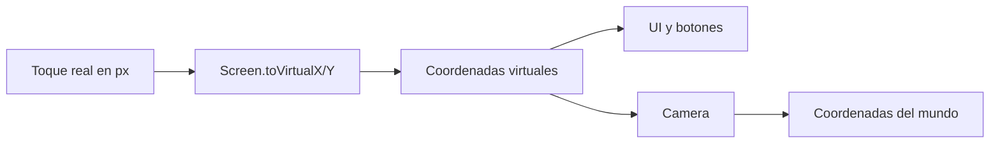
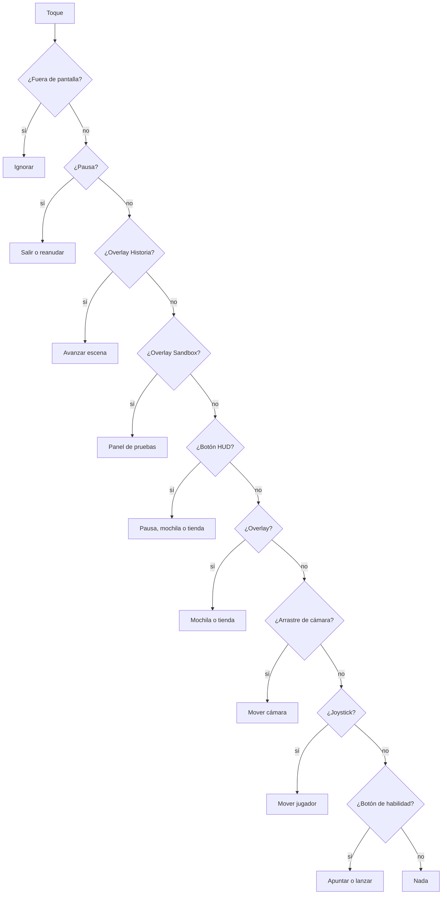

# 06 · UI, controles y móvil

## Dos sistemas de coordenadas

El juego dibuja en una **resolución virtual** y LÖVE escala al tamaño real del
teléfono.

- Altura lógica fija: **540**.
- Ancho lógico: **960** en 16:9, pero crece en pantallas más anchas.
- En pantallas más angostas que 16:9 se mantiene 960x540 y se agregan barras.



Por eso:

- Usa `Screen.width` y `Screen.height` para la UI.
- Usa `Camera` solo para lo que vive dentro de la mazmorra.
- Nunca uses `love.graphics.getWidth()` para posicionar UI.
- Nunca asumas que el ancho es 960.

En `main.lua`, los eventos de ratón y toque ya llegan convertidos a coordenadas
virtuales. Si agregas una pantalla nueva, recibe `x, y` virtuales directamente.

## Regla de oro del layout

Ancla los elementos a un borde o al centro, y deja márgenes de **10 a 16 px
virtuales** como mínimo. Para zonas críticas, usa 24 px.

```lua
local Screen = require("src.utils.screen")

function MiPantalla.layout()
  local width, height = Screen.width, Screen.height
  local panelW = math.min(width - 80, 720)
  local panelH = math.min(height - 40, 460)

  MiPantalla.panel = {
    x = (width - panelW) * 0.5,
    y = (height - panelH) * 0.5,
    w = panelW,
    h = panelH,
  }

  MiPantalla.back = {
    x = MiPantalla.panel.x + panelW - 180,
    y = MiPantalla.panel.y + panelH - 54,
    w = 160,
    h = 40,
  }
end
```

No guardes posiciones calculadas una sola vez al iniciar: la pantalla puede
cambiar de tamaño o rotar. Recalcula en `enter`, `layout` y antes de dibujar.

## Zonas de la pantalla de juego

```text
┌──────────────────────────────────────────────────────┐
│ HUD superior izquierdo               PAUSA  MOCHILA  │
│ vida, XP, maná, nivel                TIENDA          │
│                                                      │
│                                                      │
│              centro: arrastra para mirar             │
│                                                      │
│  joystick flotante                      A4           │
│  zona izquierda                     A3      A2       │
│  x < 360, y > 120                        A1          │
│                 inventario activo en la franja       │
└──────────────────────────────────────────────────────┘
```

### Joystick

- Se activa con un toque en `x < 360` y `y > 120`.
- Es flotante: aparece donde tocas, no en una posición fija.
- Radio máximo: **62**; el knob se dibuja de radio **24**.
- Devuelve `dx` y `dy` normalizados entre -1 y 1.
- Se cancela al pausar o perder el foco.

No cambies la zona sin revisar `Util.inJoystickZone` y el arrastre de cámara: el
centro de la pantalla se reserva para mirar alrededor.

### Botones de habilidad

Son un diamante anclado a la esquina inferior derecha:

- A1: asignable desde la mochila.
- A2: asignable desde la mochila.
- A3: Escudo, siempre disponible.
- A4: Turbo, siempre disponible.
- Radio de toque: **42**.
- A1 y A2 se apuntan arrastrando y se lanzan al soltar.
- A3 y A4 se ejecutan al instante.

La lógica está en `src/utils/buttons.lua` y el apuntado en `src/run/aim.lua`.
`Aim` solo activa el arrastre después de **18 px**, para no confundir un toque
corto con un apuntado.

### HUD

- Panel superior izquierdo: vida, escudo, XP, maná, nivel, personaje y pulso.
- Botones superiores derechos: pausa, mochila, tienda.
- Inventario activo: franja centrada abajo, en `y = 493`.
- Barra de jefe: centrada arriba.
- La tienda solo se abre si se cumplen nivel de personaje y piso.

Si agregas un botón al HUD, revisa `HUD.layout()` y su `hit...` correspondiente.
El dibujo y el hit test deben usar el mismo rectángulo.

## Controles de teclado

En escritorio y para pruebas:

| Tecla | Acción |
|---|---|
| `WASD` o flechas | Mover |
| `R`, `F`, `E`, `T` | Habilidades A1, A2, A3, A4 |
| `B` | Mochila |
| `V` | Tienda |
| `P` o `Esc` | Pausa |
| `Esc` | Cerrar overlay |
| `M` | Silenciar |
| `F2` | Alternar sandbox dentro de una run |
| `F3` | Overlay de depuración |

La UI móvil se activa solo si `Util.isMobile()` detecta Android o iOS. En
escritorio se usan teclado y ratón; no dependas de botones táctiles para probar
en Termux:X11.

## Entrada táctil y ratón

`main.lua` separa los eventos:

- `touchpressed` / `touchmoved` / `touchreleased` para dedos.
- `mousepressed` / `mousemoved` / `mousereleased` para ratón.
- Los callbacks de ratón **ignoran** eventos con `istouch = true` para no duplicar.

Una pantalla nueva debe implementar ambos si quiere funcionar en Android y en
escritorio:

```lua
function MiPantalla.touchpressed(id, x, y)
  MiPantalla.pressed(x, y)
end

function MiPantalla.mousepressed(x, y, button)
  if button == 1 then
    MiPantalla.pressed(x, y)
  end
end
```

No metas `love.touch` directamente en la lógica de juego. Usa los callbacks del
estado y las coordenadas virtuales.

## Orden de prioridad de toques

En una run, el orden importa. Un toque no debe atravesar un panel modal.



Este orden está en `Run:pressedAt`. Si agregas un overlay, agrégalo antes de la
cámara y del joystick, y absorbe el toque con `return`.

## Pausa, foco y segundo plano

- `P` o el botón `PAUSA` pausan la partida.
- Al pausar se cierra el overlay, se limpia el input, se pausa la música y se
  guarda automáticamente.
- Al perder el foco (`love.focus(false)`) la run se pausa.
- Al ocultarse la app (`love.visible(false)`) se escribe el guardado.
- Al cerrar (`love.quit`) se guarda.
- `Esc` en pausa pide confirmación antes de salir al menú.
- El primer toque en “Salir” arma la confirmación; el segundo sale.

Nunca dejes el joystick activo al pausar: el jugador seguiría moviéndose al
volver. Usa `joystick:cancel()` y `Run:clearInput()`.

## Texto y fuentes

Las fuentes son las de LÖVE, sin archivos externos:

| Fuente | Tamaño | Uso |
|---|---|---|
| `Fonts.title` | 30 | Títulos de pantalla |
| `Fonts.subtitle` | 15 | Subtítulos |
| `Fonts.body` | 14 | Texto normal |
| `Fonts.button` | 16 | Botones |
| `Fonts.small` | 11 | HUD y textos densos |

### `TextCache`

`TextCache.format(key, fmt, ...)` evita crear strings nuevos cada frame. Reglas:

- La clave debe ser **literal y fija** por sitio de llamada.
- El formato debe ser literal.
- No pases `nil` como argumento.
- No construyas claves dinámicas con concatenación.
- Cuantiza números que cambian rápido (por ejemplo, décimas) para no fallar la
  caché 60 veces por segundo.

```lua
-- Correcto: clave fija, formato fijo, argumentos estables.
local text = TextCache.format("mi-hud-nivel", "Nv. %d", level)

-- Incorrecto: crea una clave nueva por frame.
local text = TextCache.format("mi-hud-" .. id, "Nv. %d", level)
```

## Tamaños táctiles

- Un botón táctil debe medir al menos **84 px virtuales de diámetro** (radio 42).
- Los botones rectangulares del HUD miden al menos **36 px de alto**.
- Deja separación entre botones; un dedo cubre más que un cursor.
- No pongas acciones destructivas junto a acciones frecuentes.
- En pantallas 20:9, revisa que los botones no queden bajo el gesto del sistema.

No hay una API de “safe area” de notch en este código. Si el dispositivo tiene
notch o barra de gestos, deja márgenes adicionales y pruébalo en el teléfono real.

## Pruebas de UI

1. Abre la pantalla en 16:9 (960x540) y en 20:9 (1200x540).
2. Toca todos los botones con el pulgar.
3. Comprueba que un toque en un overlay no activa el joystick detrás.
4. Pausa, cambia de app y vuelve: la partida debe seguir pausada.
5. Revisa que el texto no se corte ni se superponga.
6. Ejecuta `sh src/tools/test_all.sh`.
7. Empaqueta y prueba en LÖVE for Android.

## Errores comunes

| Síntoma | Causa probable | Solución |
|---|---|---|
| La UI se sale en pantallas anchas | Usaste 960 fijo | Usar `Screen.width` |
| El toque no coincide con el dibujo | Mezclaste coordenadas reales y virtuales | Convertir en `main.lua` o usar virtuales |
| El botón se ve pero no responde | Hit test con otro rectángulo | Compartir el mismo `layout()` |
| El jugador sigue moviéndose al pausar | No cancelaste el joystick | `joystick:cancel()` y `clearInput()` |
| El texto se ve borroso | Escalaste fuente o usaste imagen | Usar `Fonts` y `TextCache` |
| Se activa un botón detrás de un panel | Falta `return` en el overlay | Absorber el toque |
| Se pierde el progreso al cambiar de app | No se guarda en foco/visible | Mantener `autosave` y `love.visible` |
