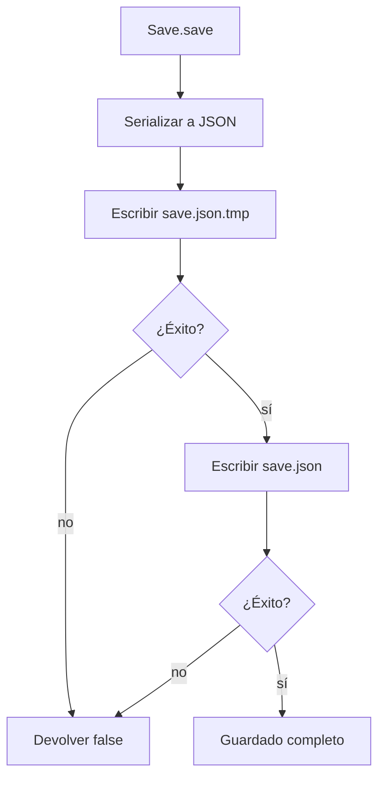
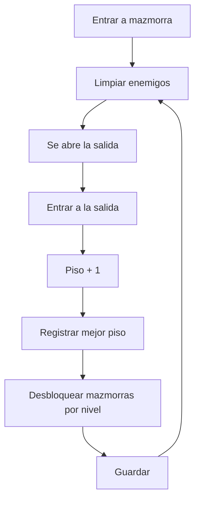
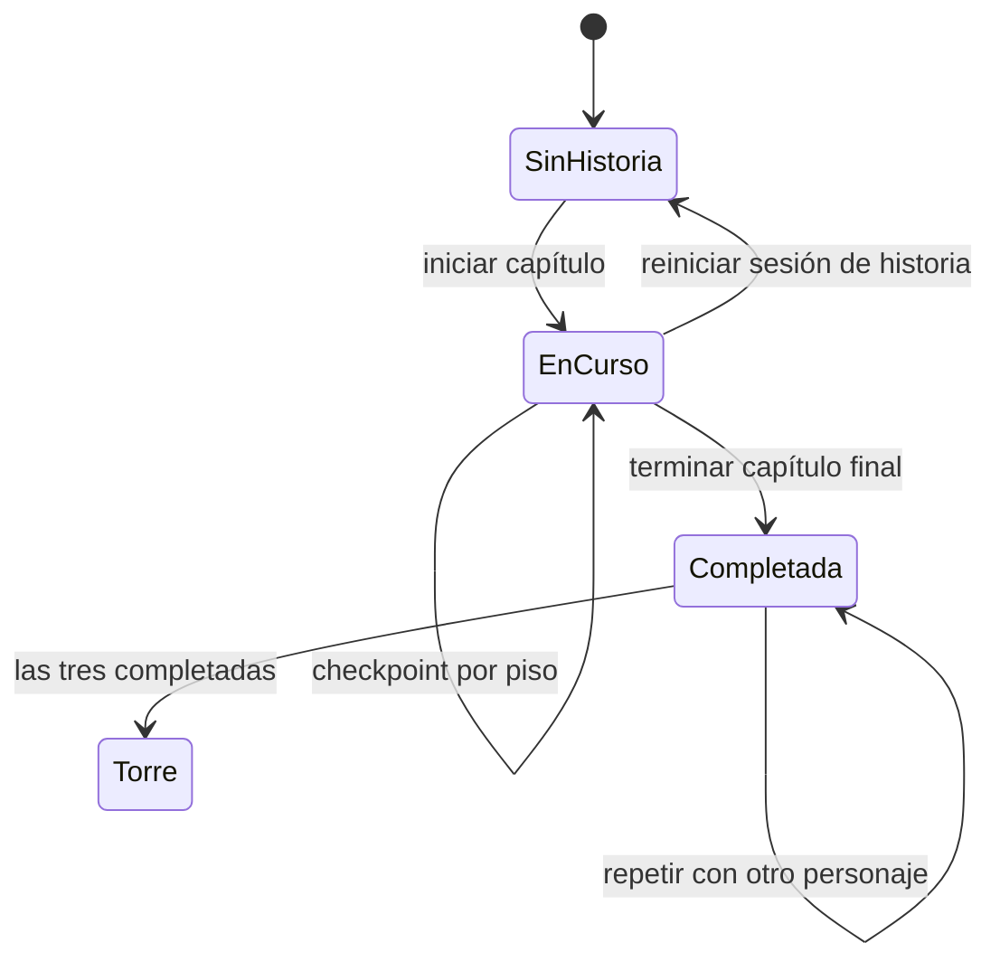

# 07 · Guardado y progresión

## Qué se guarda y qué no

Una run es temporal. La **meta-progresión** es permanente.

| Vive en la run | Vive en el guardado |
|---|---|
| Vida, maná, XP de la run | Monedas |
| Enemigos, balas, hazards | Mejor piso alcanzado |
| Mazmorra generada | Mazmorras desbloqueadas |
| Inventario activo de la run | Personajes desbloqueados |
| Semilla de la run | Mejoras por personaje |
| Tiempo restante | Resonancia por personaje |
| Mascotas de la run | Bestiario |
| Overlays abiertos | Ajustes de audio |
| | Checkpoint de Historia |
| | Historias completadas |

Morir no borra la meta-progresión. Lo que se pierde es el estado de la run.

## Dónde está el archivo

- Identidad de LÖVE: `vaporcode` (`conf.lua`).
- Archivo principal: `save.json`.
- Respaldo: `save.json.tmp`.
- Ubicación: la carpeta de guardado de LÖVE, obtenida con
  `love.filesystem.getSaveDirectory()`.
- En Android vive dentro del almacenamiento privado de la app; no está en
  `/sdcard` y no se comparte entre instalaciones.
- En Termux vive en la carpeta de guardado de LÖVE para el usuario.

No edites el archivo a mano en el teléfono salvo que sepas exactamente lo que
haces. Usa Configuración → Borrar datos para reiniciar el progreso.

## Cómo se escribe



El respaldo se conserva a propósito. Si Android mata el proceso mientras se
escribe el archivo principal, la próxima carga usa `save.json.tmp` y repara el
principal.

Al cargar:

1. Se intenta leer `save.json`.
2. Si no existe o está roto, se intenta `save.json.tmp`.
3. Se normaliza todo: tipos, rangos, ids válidos y valores por defecto.
4. Si se recuperó desde el respaldo, se reescribe el principal.
5. Si no hay nada válido, se usan los valores por defecto sin romper.

## Cuándo se guarda

- Al pausar (`P` o botón `PAUSA`).
- Al salir al menú.
- Al avanzar de piso.
- Al morir.
- Al completar una Historia.
- Al guardar un checkpoint de Historia al entrar a un piso.
- Al desbloquear un personaje.
- Al desbloquear una mazmorra.
- Al descubrir un enemigo.
- Al cambiar volúmenes.
- Al usar resonancia.
- Al ocultarse la app (`love.visible(false)`).
- Al cerrar (`love.quit`).

En sandbox **no** se guarda progreso. Puedes probar sin miedo.

### Monedas y momentos de guardado

Las monedas se suman en memoria durante la run. No se escribe el archivo en cada
moneda, para no desgastar el almacenamiento ni causar tirones. Se persisten en el
siguiente autosave (pausa, piso, muerte o salida). Si el proceso muere de golpe
entre una moneda y un autosave, esa moneda puede perderse. Es un intercambio
deliberado entre rendimiento y exactitud.

## Estructura del guardado v5

```json
{
  "version": 5,
  "coins": 120,
  "bestLevel": 7,
  "unlocked": {
    "cripta": true,
    "forja": true,
    "catedral": false,
    "torre": false
  },
  "characters": {
    "amado": true,
    "mar": true,
    "amileth": false
  },
  "progress": {
    "amado": {
      "upgrades": { "damage": 2, "maxHp": 1, "speed": 0 },
      "resonance": 3,
      "storyCompleted": true
    },
    "mar": {
      "upgrades": { "damage": 0, "maxHp": 0, "speed": 0 },
      "resonance": 0,
      "storyCompleted": false
    },
    "amileth": {
      "upgrades": { "damage": 0, "maxHp": 0, "speed": 0 },
      "resonance": 0,
      "storyCompleted": false
    }
  },
  "bestiary": {
    "automaton": true
  },
  "settings": {
    "musicVolume": 0.6,
    "effectsVolume": 0.8
  },
  "story": {
    "active": false,
    "completed": false,
    "chapterId": null,
    "depth": 1,
    "characterId": "amado",
    "checkpoint": null
  }
}
```

Los nombres exactos pueden variar si el guardado tiene un checkpoint, pero estos
campos son la base.

## Reglas de normalización

- `coins` y `bestLevel` se redondean y no pueden ser negativos.
- Los volúmenes se acotan entre 0 y 1.
- Las mejoras se limitan a `Data.upgrades[id].maxLevel`.
- Las mejoras de personajes desconocidos se descartan.
- `amado` y `cripta` siempre están desbloqueados.
- Solo se conservan personajes, enemigos y mazmorras que existen en los datos.
- Un checkpoint solo es válido si tiene todos los campos requeridos y su piso
  está dentro del capítulo.
- La Torre se desbloquea solo si las Historias de todos los personajes están
  completadas.

Si agregas un campo nuevo, agrégalo también a `defaults()` y a `normalize()`.
Nunca confíes en que el archivo en disco tiene el formato correcto.

## Guardado por personaje

Cada personaje tiene su propio progreso:

```lua
Save.progressFor("amado")
Save.upgradeLevel("damage", "amado")
Save.addResonance("amado", 1)
Save.useResonance("amado", "damage")
Save.stat("damage", "amado")
```

Las mejoras y la resonancia **no se comparten** entre personajes. Las monedas,
el Bestiario y los desbloqueos sí son de la cuenta.

## Progresión de una run libre



- `bestLevel` guarda el piso más alto alcanzado.
- Las mazmorras con `unlockLevel` se abren al alcanzar ese piso.
- Las mazmorras con `storyUnlock` no se abren por piso.
- La Torre es especial: exige completar las tres Historias.
- La run no guarda enemigos ni posición; al continuar se empieza el piso de nuevo.

## Progresión de Historia

- La Historia tiene cuatro capítulos: Cripta, Forja, Catedral y Torre.
- Cada capítulo tiene un rango de pisos y un jefe final.
- Al entrar a un piso de Historia se guarda un **checkpoint**.
- El checkpoint incluye semilla, piso, vida, XP, maná, stats, inventario y
  mascotas, para reanudar el piso.
- Si mueres, puedes reintentar el piso desde el checkpoint.
- Completar la Historia de un personaje marca `storyCompleted` para ese
  personaje.
- Completar las tres Historias desbloquea la Torre.
- `Save.resetStory()` borra la Historia activa, pero no las Historias ya
  completadas.



## Checkpoints

Un checkpoint válido necesita, como mínimo:

- `seed`, `dungeonId`, `depth`, `characterId`
- `playerLevel`, `hp`, `xp`, `xpToNext`
- `mana`, `manaMax`, `timeLeft`
- `stats.damage`, `stats.maxHp`, `stats.speed`, `stats.attackRate`

El guardado descarta checkpoints incompletos o fuera del rango del capítulo.
Eso evita arrancar una run en un estado imposible.

## Migraciones

La versión actual es **5**.

- La versión 4 tenía mejoras globales; al migrar se reparten entre los tres
  personajes.
- El final único anterior se asigna al personaje que completó la campaña.
- `story.completed` se conserva por compatibilidad.

Si cambias el formato:

1. **Pide confirmación** antes de tocar el guardado.
2. Sube `VERSION`.
3. Agrega una rama de migración en `normalize`.
4. Conserva los datos viejos que aún tengan sentido.
5. Agrega un test con un guardado de la versión anterior.
6. Prueba cargar, guardar y volver a cargar.

No cambies ids existentes sin migración: romperías `bestiary`, `unlocked`,
`characters` y `progress`.

## Pruebas de guardado

```bash
sh src/tools/test_all.sh
```

Tests relevantes:

- `test_save.lua`: valores por defecto, escritura, respaldo, corrupción,
  volúmenes, resonancia, mejoras y migración v4.
- `test_story.lua`: checkpoints, rangos, finales y desbloqueo de la Torre.
- `test_storage.lua`: inventario persistente de la run.
- `test_run_state.lua`: estado de la run y snapshots.

Los tests simulan `love.filesystem` en memoria. No tocan tu guardado real.

## Errores comunes

| Síntoma | Causa probable | Solución |
|---|---|---|
| Todo el progreso se perdió | Guardado inválido y sin respaldo | Revisar `save.json` y `save.json.tmp` |
| Las monedas no aparecen | Se cerró antes del autosave | Guardar al pausar o salir |
| La mejora no aplica a otro personaje | Es por personaje | Usar `characterId` correcto |
| La Torre no se abre | Falta una Historia | Completar los tres personajes |
| El checkpoint no carga | Piso fuera de rango o snapshot incompleto | Revisar `validCheckpoint` |
| El guardado no persiste en Android | Se está usando sandbox | Salir de sandbox |
| Cambié un id y se perdió el Bestiario | Ids estables | Migrar o conservar alias |
