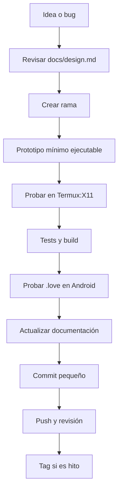

# 09 · Flujo de trabajo y convenciones

## Ciclo de trabajo



### 1. Entender antes de tocar

- Lee `docs/design.md` y el README.
- Busca si ya existe un sistema parecido.
- Decide si el cambio es de **datos**, de **lógica** o de **presentación**.
- Escribe el alcance más pequeño que ya se pueda jugar.

### 2. Rama y commits

Para cambios normales:

```bash
git switch -c feature/mi-cambio
```

Commits pequeños, en español, con verbo en presente o imperativo, siguiendo el
estilo del repositorio:

```bash
git add src/data/items.lua src/run/item_drop.lua
git commit -m "Añade imán de taller al botín"
```

Ejemplos de mensajes:

- `Añade enemigo sabueso de vapor`
- `Corrige el daño del Órgano del Tiempo`
- `Mejora la lectura del pulso fuerte`
- `Documenta el guardado v5`

No mezcles en un commit:

- refactor + feature,
- balance + UI,
- assets + lógica,
- documentación + cambios de código no relacionados.

Antes de commitear:

```bash
git status
git diff
git diff --check
```

No commitees `build/` ni `.love`: ya están en `.gitignore`. No commitees secretos,
keystores ni archivos personales.

### 3. Probar antes de decir “listo”

Un cambio está terminado cuando:

- Corre en Termux:X11 sin errores en consola.
- Responde a toque en LÖVE for Android.
- Se ve bien en 16:9 y 20:9.
- No baja de 60 FPS en una run normal.
- `sh src/tools/test_all.sh` termina en `Tests OK`.
- `sh src/tools/build.sh` genera el `.love`.
- La documentación quedó actualizada si cambió el flujo.

## Estilo de Lua

### Módulos

Todos los módulos devuelven una tabla:

```lua
local MiModulo = {}

function MiModulo.hacerAlgo(valor)
  return valor * 2
end

return MiModulo
```

- `local` por defecto.
- Solo los callbacks de LÖVE son globales (`love.load`, `love.update`, ...).
- `snake_case` para variables y funciones.
- `PascalCase` para módulos, clases y tablas que se comportan como clases.
- Dos espacios de indentación.
- Sin punto y coma al final.
- Una responsabilidad por archivo.
- Si un archivo pasa de ~300 líneas, divídelo.

### Comentarios

- Comentarios en **español**.
- Identificadores en **inglés**.
- Explica **por qué**, no lo que ya dice el código.
- No comentes código obvio.
- No dejes código muerto “por si acaso”.

```lua
-- Correcto: explica una decisión.
-- Se cuantiza a décimas para no perder la caché de texto cada frame.
local lock = math.floor(lock * 10) / 10

-- Incorrecto: repite el código.
-- Multiplica por 10 y divide entre 10.
```

### Funciones

- Reciben primero la tabla o `run` cuando son métodos de sistema.
- Devuelven valores simples y predecibles.
- Evitan efectos secundarios ocultos.
- Fallan temprano con `error` solo en configuración inválida.
- Devuelven `false` o `nil` para fallos esperables.

## Patrón de sistemas de run

Los sistemas viven en `src/run/*.lua` y no se llaman directamente desde `run.lua`.
Se **montan** como métodos:

```lua
-- src/run/mi_sistema.lua
local MiSistema = {}

function MiSistema.hacerAlgo(run, dt)
  run.algo = (run.algo or 0) + dt
end

return MiSistema
```

En `run.lua`:

```lua
local systems = {
  sys("src.run.spawner"),
  sys("src.run.combat"),
  sys("src.run.mi_sistema"),
}
```

`run:metodo(...)` se convierte en `MiSistema.metodo(run, ...)`.

Reglas:

- No definas en el sistema un método que `Run` ya tenga: el montaje lanza error.
- No uses `Run` directamente dentro del sistema; usa el parámetro `run`.
- No pongas lógica de presentación en un sistema de reglas.
- Un sistema puede leer datos con `require("src.run.data")`.

## Patrón de datos

- Los datos van en `src/data/`.
- El runtime los consume desde `src/run/data.lua`.
- No requires `src/data/*.lua` desde `src/run/`.
- No metas lógica en los datos: solo tablas y números.
- Los ids son estables y en inglés.
- Los textos visibles van en español.
- Todo número de balance va en `src/data/balance.lua` o en el dato del contenido.

```lua
-- src/data/items.lua
mi_item = {
  id = "mi_item",
  kind = "passive",
  name = "Mi ítem",
  short = "MIO",
  color = { 0.5, 0.8, 0.5 },
  desc = "Texto visible.",
  stackable = true,
  maxStacks = 5,
  weight = 10,
}
```

## Estados y presentación

- `main.lua` solo inicializa, escala y enruta.
- `src/estados.lua` enruta por nombre.
- Cada estado implementa solo los callbacks que necesita.
- La UI usa coordenadas virtuales (`Screen`).
- La lógica de juego no dibuja.
- El dibujo no modifica el estado del juego.

```lua
function MiEstado.enter(...) end
function MiEstado.update(dt) end
function MiEstado.draw() end
function MiEstado.keypressed(key, isrepeat) end
function MiEstado.touchpressed(id, x, y) end
function MiEstado.mousepressed(x, y, button) end
```

## Reglas de rendimiento

Presupuesto del dispositivo:

- 60 FPS estables.
- Menos de ~250 MB RSS.
- Sin allocaciones nuevas por frame en `update` y `draw`.
- Sin cargar imágenes o fuentes dentro del loop.
- Sin `string.format` por frame si el valor no cambió.

Prácticas:

- Reutiliza tablas y objetos.
- Limita enemigos, proyectiles y partículas.
- Usa `TextCache` para textos del HUD.
- Usa fuentes de LÖVE o bitmap fonts, no imágenes de texto.
- No dibujes lo que está fuera de cámara.
- Pausa música y lógica al perder el foco.
- Evita `love.graphics.print` masivo; mide con `F3`.
- Prueba con muchos enemigos y en el teléfono, no solo en la laptop.

## Reglas móviles

- No dependas de teclado.
- No dependas de mouse.
- Los botones táctiles deben ser grandes y estar al alcance del pulgar.
- La zona central se reserva para arrastrar la cámara.
- No pongas UI crítica en el borde inferior.
- Prueba 16:9 y 20:9.
- No uses características de OpenGL de escritorio.
- No uses LÖVE 12; el proyecto está fijado en **11.5**.

## Reglas de datos y guardado

- No cambies ids existentes sin migración.
- No cambies el formato de guardado sin acordarlo.
- Si agregas un campo persistente, agrégalo a `defaults()` y `normalize()`.
- Si rompes compatibilidad, sube `VERSION` y agrega migración.
- No guardes secretos, rutas absolutas ni datos del dispositivo.
- No uses la sala de pruebas para escribir progreso.

## Documentación

Actualiza según el cambio:

- `docs/design.md`: reglas de diseño, personajes, enemigos, balance.
- `README.md`: comandos, controles, estructura, estado del proyecto.
- `GuiaVaporCode/`: onboarding y recetas.
- Comentarios del código: solo decisiones no obvias.

No dupliques la misma explicación en tres lugares. Deja una fuente principal y
enlaza o resume en las demás.

## Debug y errores

- `F3` muestra el overlay de depuración.
- `F2` alterna la sala de pruebas dentro de una run.
- Lee la consola de Termux; los errores de LÖVE aparecen ahí.
- Si el juego se congela, revisa bucles `while` y condiciones de salida.
- Si Android mata la app, revisa memoria y guardado al perder foco.
- Si un test falla, ejecútalo solo:

```bash
lua src/tools/test_mi_test.lua
```

- Si el error es de módulo, confirma que estás en la raíz del proyecto.

## Checklist de revisión

- [ ] El cambio tiene un alcance pequeño y claro.
- [ ] Los datos están en `src/data/`.
- [ ] La lógica está en `src/run/`.
- [ ] La presentación está en `src/estados/` o `src/utils/`.
- [ ] No hay números mágicos en la lógica.
- [ ] No hay allocaciones por frame.
- [ ] No se rompió ningún id existente.
- [ ] Los tests pasan.
- [ ] El `.love` se generó y se probó.
- [ ] Se probó con toque en Android.
- [ ] La documentación está al día.
- [ ] El commit tiene un mensaje claro.
