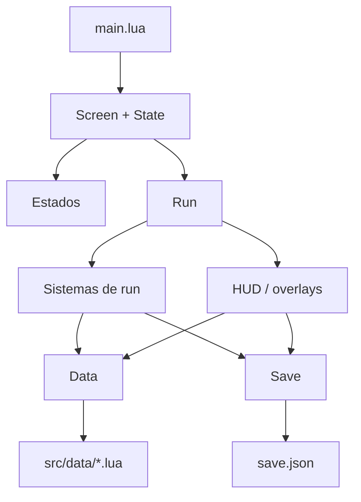

# 10 · Glosario y errores comunes

## Glosario

| Término | Significado en VaporCode |
|---|---|
| **LÖVE / Love2D** | Motor 2D y framework en Lua. El proyecto usa **11.5**. |
| **LuaJIT** | Intérprete de Lua que usa LÖVE en Android. Más rápido que Lua estándar. |
| **`.love`** | Archivo ZIP con el juego; se abre con LÖVE de escritorio o Android. |
| **Termux:X11** | Servidor gráfico para ver LÖVE en el teléfono desde Termux. |
| **LÖVE for Android** | App que ejecuta archivos `.love` en el teléfono. |
| **Resolución virtual** | Coordenadas lógicas del juego: altura 540, ancho variable. |
| **Escala** | Factor que convierte píxeles virtuales a píxeles reales. |
| **Letterbox** | Barras que aparecen cuando el aspecto no coincide. |
| **Cámara** | Transformación que decide qué parte del mundo se ve. |
| **Mundo** | Coordenadas de la mazmorra, distintas de las de UI. |
| **Run / partida** | Una sesión de juego desde que entras hasta que mueres o sales. |
| **Piso / depth** | Nivel actual dentro de una run. |
| **Mazmorra / dungeon** | Tema y reglas de generación de una run. |
| **Semilla / seed** | Número que hace reproducible la generación procedural. |
| **Jefe / boss** | Enemigo especial; aparece cada 3 pisos o al final de un capítulo. |
| **Élite** | Enemigo normal con un modificador (volátil, blindado, espectral). |
| **Rol** | Comportamiento de IA: chaser, turret, ranged, mortar, summoner, etc. |
| **Hazard** | Peligro del piso: fuego, minas, rayos. |
| **Overlay** | Panel que se dibuja encima de la run: mochila, tienda, pausa, Historia. |
| **Modal** | Overlay que absorbe todos los toques y no deja interactuar detrás. |
| **HUD** | Interfaz fija: vida, XP, maná, monedas, botones. |
| **Joystick flotante** | Control táctil que aparece donde tocas la zona izquierda. |
| **Aim** | Estado de apuntado con arrastre para A1 y A2. |
| **Ranura / slot** | Espacio de habilidad: A1, A2, A3, A4. |
| **Resonancia** | Punto permanente que suelta un jefe; sube mejoras del personaje. |
| **Meta-progresión** | Progreso que sobrevive entre runs: monedas, mejoras, desbloqueos. |
| **Bestiario** | Registro persistente de enemigos y jefes vistos. |
| **Checkpoint** | Instantánea de un piso de Historia para continuar. |
| **Acto / capítulo** | Divisiones narrativas de la campaña. |
| **Sandbox** | Sala de pruebas aislada; no guarda progreso. |
| **Stacks** | Acumulaciones de un ítem pasivo. |
| **Alquimia** | Combinar dos pasivos guardados iguales para subir su nivel. |
| **LOS** | Línea de visión; algunos ataques la necesitan. |
| **DPS** | Daño por segundo. |
| **RSS** | Memoria residente del proceso; el presupuesto es ~250 MB. |
| **FPS** | Cuadros por segundo; el objetivo es 60. |
| **MVP** | Versión mínima jugable. |
| **V9** | Estado actual del prototipo. |
| **Guardado v5** | Formato actual de `save.json`. |

## Mapa mental del proyecto



- ¿Dónde cambio un número? En `src/data/`.
- ¿Dónde cambio una regla? En `src/run/`.
- ¿Dónde cambio una pantalla? En `src/estados/` o `src/run/*_view.lua`.
- ¿Dónde cambio un control? En `src/utils/input.lua`, `joystick.lua`, `buttons.lua` o `run.lua`.
- ¿Dónde cambio el guardado? En `src/run/save.lua`.

## Errores frecuentes

### `module 'src...' not found`

**Causa:** ejecutaste el archivo desde otra carpeta.
**Solución:** corre desde la raíz del proyecto:

```bash
cd ~/juegos/vaporcode
sh src/tools/test_all.sh
```

### `attempt to index a nil value (global 'love')`

**Causa:** un test no definió el stub de `love` que el módulo necesita.
**Solución:** agrega la tabla y las funciones usadas al inicio del test.

### `attempt to call a nil value (field 'graphics')`

**Causa:** el test de UI usa una función de `love.graphics` que no está simulada.
**Solución:** agrégala al stub de `test_ui_smoke.lua` o al test correspondiente.

### `attempt to compare number with boolean`

**Causa:** un campo numérico recibió `true`, casi siempre `keepDistance = true`.
**Solución:** usa `false` o un número. Revisa `test_data.lua`.

### `Run ya define <metodo>`

**Causa:** un sistema de `src/run/` define un método que `Run` ya tiene.
**Solución:** renombra el método del sistema. El montaje es estricto a propósito.

### `Data.<algo> es nil`

**Causa:** el dato no existe, el id está mal escrito o no se expuso en
`src/run/data.lua`.
**Solución:** verifica el id, el archivo de datos y el compositor.

### `attempt to index nil (field 'stats')`

**Causa:** un checkpoint o snapshot incompleto.
**Solución:** revisa `validCheckpoint` y los campos requeridos.

### El juego abre en negro

**Causa probable:** error en `draw`, estado sin `draw`, o scissor mal cerrado.
**Solución:** mira la consola de Termux; si no hay error, revisa `Screen.push/pop`
y el `State.current`.

### El toque no hace nada

**Causa:** la pantalla solo implementa `mousepressed`, o el botón no está en la
zona táctil, o un overlay está absorbiendo el toque.
**Solución:** implementa `touchpressed`, revisa el hit test y el orden de
`Run:pressedAt`.

### El botón se ve pero no responde

**Causa:** el dibujo y el hit test usan rectángulos distintos.
**Solución:** comparte el mismo `layout()` y el mismo rectángulo.

### El jugador sigue moviéndose al pausar

**Causa:** el joystick quedó activo.
**Solución:** `joystick:cancel()` y `Run:clearInput()` al pausar.

### No se guarda el progreso

**Causa:** estás en sandbox, la app murió antes del autosave, o el guardado está
corrupto.
**Solución:** sal de sandbox, pausa para forzar autosave y revisa
`save.json`/`save.json.tmp`.

### El `.love` falla solo en Android

**Causa:** falta un archivo en el ZIP, sobre todo `assets/` o un módulo nuevo.
**Solución:** actualiza `build.sh`, vuelve a empaquetar y prueba el `.love`, no la
carpeta.

### Android no abre el `.love`

**Causa:** se intentó abrir con `file://` o con `am start`.
**Solución:** usa `termux-share` y abre con LÖVE for Android 11.5 o LÖVE Loader.

### `This game was made for LÖVE 11.5`

**Causa:** estás usando LÖVE 12 o una versión incompatible.
**Solución:** instala LÖVE 11.5 en Termux, escritorio y Android.

### No hay sonido

**Causa:** volumen en cero, mute activo, app en segundo plano o audio no iniciado.
**Solución:** revisa Configuración, pulsa `M`, vuelve a enfocar la app y prueba
en el teléfono.

### Va lento o se calienta

**Causa:** demasiadas entidades, allocaciones por frame, texto sin caché o
dibujo fuera de cámara.
**Solución:** reduce entidades, usa `TextCache`, reutiliza tablas, revisa `F3` y
prueba en el teléfono.

### El texto se superpone en pantallas anchas

**Causa:** posiciones fijas de 960 px.
**Solución:** usa `Screen.width` y ancla al borde o al centro.

### Un test pasa pero el juego falla

**Causa:** los tests simulan LÖVE; no cubren gráficos, audio ni touch real.
**Solución:** ejecuta `love .` y prueba el `.love` en Android.

### `luac -p` pasa pero el juego falla

**Causa:** `luac` solo valida sintaxis, no referencias nil ni lógica.
**Solución:** ejecuta el juego y los tests.

## Cómo pedir ayuda

Incluye:

1. Qué querías hacer.
2. Qué comando ejecutaste.
3. Qué esperabas.
4. Qué pasó.
5. El error completo de la consola.
6. El archivo y la línea (`src/run/enemy.lua:351`).
7. Si pasa en Termux:X11, en Android o en ambos.

No pegues solo “no funciona”. El error y el contexto ahorran tiempo.

## Dónde buscar

| Necesito… | Archivo |
|---|---|
| Entender el arranque | `main.lua`, `conf.lua` |
| Entender estados | `src/estados.lua` |
| Entender una run | `src/run/run.lua` |
| Cambiar balance | `src/data/balance.lua` |
| Cambiar enemigos | `src/data/enemies.lua`, `src/run/enemy.lua` |
| Cambiar jefes | `src/data/bosses.lua`, `src/run/boss.lua` |
| Cambiar ítems | `src/data/items.lua`, `src/run/inventory.lua` |
| Cambiar habilidades | `src/data/abilities.lua`, `src/run/abilities.lua` |
| Cambiar mazmorras | `src/data/dungeons.lua`, `src/run/dungeon.lua` |
| Cambiar Historia | `src/data/story.lua`, `src/run/story_flow.lua` |
| Cambiar guardado | `src/run/save.lua` |
| Cambiar UI | `src/run/hud.lua`, `src/utils/buttons.lua` |
| Cambiar controles | `src/utils/input.lua`, `src/utils/joystick.lua` |
| Cambiar tests | `src/tools/test_*.lua` |
| Empaquetar | `src/tools/build.sh` |

## Última regla

Si no puedes explicar el cambio en una frase, probablemente es demasiado grande.
Divide, prueba, documenta y vuelve a empezar.
