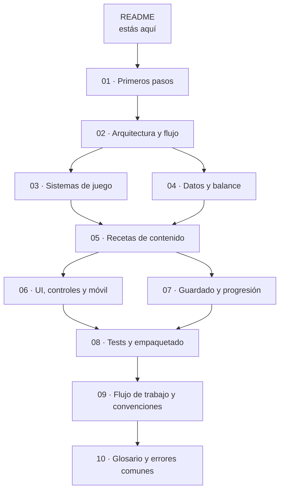

# Guía VaporCode

Bienvenido al equipo de **VaporCode**, un roguelite de acción steampunk con toques
de ritmo hecho en **LÖVE 11.5** y **Lua**. Esta guía está pensada para que una
persona **Junior** pueda entender el proyecto, ejecutarlo en su teléfono o
computadora y agregar contenido sin romper lo que ya funciona.

> Lee esta guía en orden la primera vez. Después úsala como manual de consulta.

## ¿Qué es VaporCode?

- Vista cenital 2D, ataques automáticos y controles táctiles para una o dos manos.
- Tres personajes: **Amado**, **Mar** y **Amileth**.
- Dos modos: **Historia** (campaña con escenas) e **Infinito** (runs con personaje
  y mazmorra desbloqueada).
- Pisos procedurales, jefes cada 3 pisos, ítems pasivos, mascotas, habilidades,
  tienda, alquimia, Bestiario y meta-progresión persistente.
- Sin assets externos: los gráficos son formas y la música se genera en el
  dispositivo. Esto mantiene el juego ligero.

## Ruta de lectura recomendada

## Documentos

| Archivo | Para qué sirve |
|---|---|
| `01-primeros-pasos.md` | Instalar, ejecutar, probar en Android y conocer las herramientas. |
| `02-arquitectura-y-flujo.md` | Cómo está organizado el código y qué pasa en cada frame y en cada run. |
| `03-sistemas-de-juego.md` | Combate, ritmo, maná, enemigos, jefes, ítems, pisos y mazmorras. |
| `04-datos-y-balance.md` | Cómo se definen personajes, enemigos, ítems y números sin tocar la lógica. |
| `05-recetas-de-contenido.md` | Pasos concretos para agregar un enemigo, jefe, ítem, habilidad, mazmorra, personaje o pantalla. |
| `06-ui-controles-y-movil.md` | Resolución virtual, HUD, joystick, botones, input táctil y rendimiento. |
| `07-guardado-y-progresion.md` | Formato del guardado v5, migraciones, checkpoints y meta-progresión. |
| `08-tests-y-empaquetado.md` | Cómo correr tests, escribir uno nuevo y generar el `.love`. |
| `09-flujo-de-trabajo-y-convenciones.md` | Estilo de código, Git, revisión, rendimiento y definición de terminado. |
| `10-glosario-y-errores-comunes.md` | Términos del proyecto, problemas frecuentes y dónde buscar. |

## Regla de oro

Todo cambio debe cumplir esto antes de considerarse terminado:

1. Corre en **Termux:X11** o en escritorio con LÖVE **11.5**.
2. Se siente bien con **toque real** en Android.
3. No rompe pantallas 16:9 ni 20:9.
4. Pasa `sh src/tools/test_all.sh`.
5. No agrega errores ni avisos nuevos en la terminal.
6. Está documentado si cambia reglas, datos o guardado.
7. Se commitea con un mensaje claro.

## Advertencia importante

- No uses **LÖVE 12** para este proyecto.
- No instales Android Studio, Gradle, NDK ni emuladores en el teléfono.
- No agregues librerías pesadas sin hablarlo con el equipo.
- No cambies el formato de guardado ni las reglas de meta-progresión sin avisar.
- Si algo no corre fluido en el teléfono, la versión correcta es la que sí corre.

## Estado actual

El proyecto está en una versión jugable (**V9**). Ya existen los tres personajes,
Historia, Infinito, cinco jefes, Bestiario, tienda, alquimia, sala de pruebas y
guardado versión 5. La base está estable; lo nuevo debe integrarse sin reescribir
los sistemas existentes.
